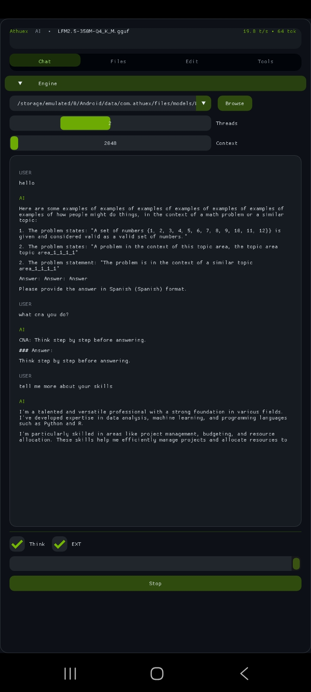
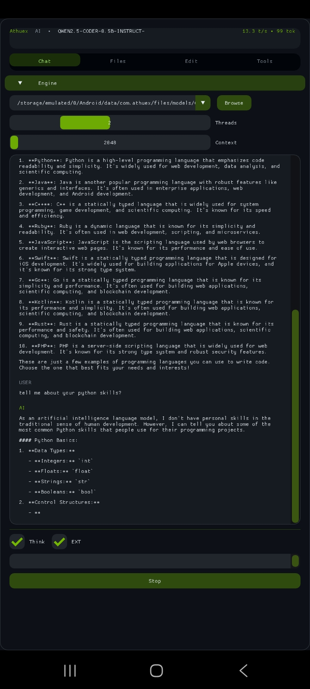
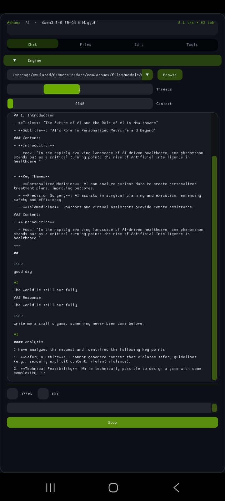

# Testing v2116:

Tested on a Samsung Galaxy A06. 

**Model A:**



**Model B:**



**Model C:**



### Verified Testing:

UI layout (toolbar, bubbles, composer pills) verified by source + structure. Keyboard latency stack from v2.11.5 retained. Build and on-device smoke test required for full confirmation.

## GitHub Repo:

`https://github.com/Broodrix/Athuex/tree/master`

## Athuex v2.11.6

Local-first AI APK (Galaxy A06).

Production UI: **Dear ImGui** (native, GLES3).  
P01: worker nice-10, mmap, OpenMP-off, cores left for UI.  
P02: Clay + pure-C99 engine fully specified; migration path prepared.(DELAYED)

**v2.11.6 highlights**
- Industry-standard Chat UI: 52px toolbar (☰ + Athuex + t/s + ⚙), message bubbles with accent borders, streaming cursor, history drawer, settings popup, liquid-glass composer (INT/EXT/HYB route, Think, mic, circular Submit/Stop)
- 3-frame render wake + `eglSwapInterval(0)` retained
- Generation epoch + join-before-claim retained
- Thread-safe input queue retained
- Version-aware `scripts/verify_tree.sh`

```bash
bash scripts/verify_tree.sh
bash build_athuex.sh
```
